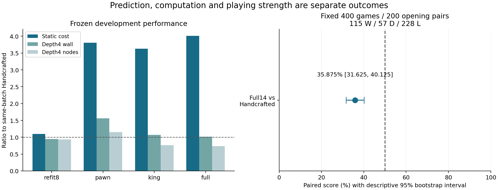
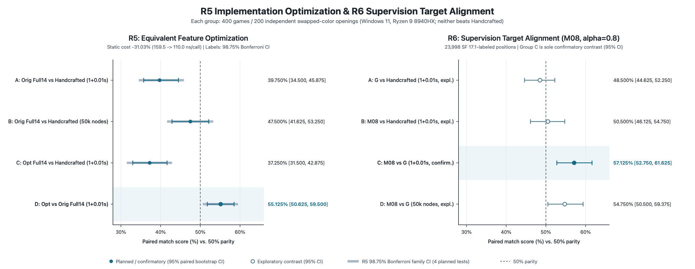
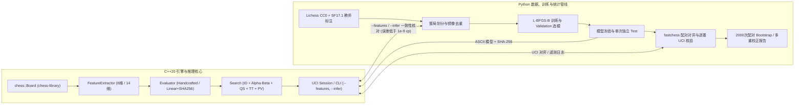

# Ultramarine Chess Lab

Ultramarine Chess Lab 是一个从零构建的**研究型 UCI 国际象棋引擎与可复现实验平台**（C++20 + Python）。项目不以盲目堆砌技巧或零散调参追逐 Elo 为目标，而是围绕**搜索算法行为、静态评估计算开销、可解释特征表示与监督目标对齐**建立严格受控的实证闭环——默认保持手工评估器 `Handcrafted`，所有算法与模型结论均需经过防泄漏划分、冻结独立测试、开局换色配对与 Bootstrap 置信区间检验。

## 核心能力

- **C++20 国际象棋引擎**：基于内置 MIT `chess-library` 与 `picosha2` 实现零网络构建，提供标准棋规则、UCI 协议、`jthread` 异步搜索，以及带格式/维度/范围/SHA-256 校验的版本化线性模型加载（`--features` / `--features-v2` / `--infer`）；通过 Perft、C++ 单元测试、Black-box UCI 与 ASan/UBSan 回归。
- **经典搜索算法**：实现迭代加深 fail-soft Negamax / Alpha-Beta，支持独立开关静态搜索（QS）、置换表（TT）与主变例排序（PV Ordering），并通过 R2 八组合消融基准（720 次查询）与穷举 Minimax 对照核验剪枝与搜索语义。
- **Python 数据与机器学习管线**：支持 Lichess CC0 PGN 有界获取、按 `game_id` 切分与跨集合精确/颜色镜像去重，全量核对 C++ 与 `python-chess` 特征/推理一致性（误差 `< 1e-9` cp），使用 NumPy/SciPy L-BFGS-B 训练正则化线性评估器并开展 Stockfish 教师软目标对齐研究。
- **自动化对弈及统计评估**：封装 `fastchess` 编排与 UCI 合规检测，执行同开局换色配对与逐着 PGN/UCI 遥测核验；以整局或配对为聚类单元计算 2000 次 Bootstrap 置信区间与多重比较校正，严格区分确认性与探索性结论，并内置日常 Stockfish 17.1 限强参考标尺（`scripts/elo.py`）。

## 代表性研究成果

### 阶段研究概览（R1–R6）

| 阶段 | 研究主题 | 关键样本 / 验证规模 | 核心实证结论 | 详细文档 |
|---|---|---|---|---|
| **R1** | 引擎基线与验证体系 | 64 项 C++ 检查、Perft、UCI 合规 40/40 | 建立零差异规则/Minimax 对照与跨平台工程回归基线 | [history.md](docs/validation/history.md) |
| **R2** | QS / TT / PV 搜索消融 | 10 局面 × 8 组合（720 查询）、16 局流程赛 | depth 4 开启 QS 时，启用 TT+PV 使节点 **-31.49%**、wall **-15.75%** | [r2-ablation](experiments/results/r2-ablation-final-20261015/report.md) |
| **R3** | 8 维线性评估闭环 | 908 局 / 6,039 局面，32 局正式赛 | 独立 test BCE 差异区间跨零；32 局得分 `45.3125%`，未证明提升 | [R3 报告](docs/r3/final-report.md) |
| **R4** | 跨时间泛化与 14 维消融 | 6 窗口 6,670 局 / 44,681 局面，400 局正式赛 | 未来 test BCE 降至 `0.596512`，但静态耗时 **4.01×**、实战仅 **35.875%** | [R4 报告](docs/r4/final-report.md) |
| **R5** | 等价性能优化与预算隔离 | 48,815 局面等价核验，4 组共 1,600 局 | 静态耗时 **-31.03%**；优化版对原版 **55.125%**（98.75% CI `[50.625%, 59.500%]`），仍负于 Handcrafted | [R5 报告](docs/r5/final-report.md) |
| **R6** | 监督目标对齐（G / T / M） | 23,998 双标签局面，4 组共 1,600 局 | 混合监督 `M08` 相对同数据 `G` 得分 **57.125%**（95% CI `[52.750%, 61.625%]`）；均未证明优于 Handcrafted | [R6 报告](docs/r6/final-report.md) |

### 已验证核心发现

1. **搜索算法消融（R2）**：在固定 10 局面与 `depth 4` 下，开启 QS 语义后，联合启用 TT 与 PV 排序相比仅开启 QS 将中位搜索节点从 `389,687` 降至 `266,968`（`-31.49%`）、中位墙钟耗时由 `111.08 ms` 降至 `93.59 ms`（`-15.75%`）；R2 对 R1 的 16 局小样本流程对照为 `13W / 3D / 0L`（仅作集成基线核验，不作为 Elo 结论）。
2. **离线预测与实战棋力的背离（R4）**：扩展至 6 个 Lichess 月度窗口与 14 维 `interpretable-v2` 特征后，`full14` 在跨时间独立未来测试集（`2,173` 局 / `14,570` 局面）上将等棋局 BCE 从 Handcrafted 的 `0.608264` 改善至 `0.596512`（王安全/残局阶段组贡献显著，相对 8 维重拟合改善 `-0.005091`，99% Bonferroni 区间 `[-0.008698, -0.001258]`）。然而在固定 400 局实战（`1+0.01s`，Mac；含 UCI `depth 0` 输出缺陷修复前 120 局与续跑 280 局）中，`full14` 仅得 **`35.875%`**（`115W / 57D / 228L`，配对 95% 区间 `[31.625%, 40.125%]`，条件 Elo 等效 `-100.89`），静态评估单次耗时达到 Handcrafted 的 `4.01×`（`113.949` vs `28.442 ns/call`），实战聚合 NPS 下降约 `31.2%`。这说明**离线损失改善、评估吞吐与搜索实战棋力不能相互替代**。
3. **等价实现优化的条件性收益（R5）**：在 Windows 11 / Ryzen 9 8940HX 平台上，通过预计算通路兵掩码与合并扫描对 14 维特征提取进行严格等价优化（经 `48,815` 局面与 `366` 搜索查询逐项精确核对，binary64 与整数评分零差异），静态评估均值中位数耗时从 `159.4984` 降至 `110.0119 ns/call`（**下降 `31.03%`**）。在同 200 独立开局的四组 1,600 局正式对比中（四比较 Bonferroni 名义 98.75% 区间）：
   - **D 组（`Optimized Full14` vs `Original Full14`，`1+0.01s`）**：得分 **`55.125%`**（`192W / 57D / 151L`，98.75% CI **`[50.625%, 59.500%]`**，条件 Elo `+35.74`），支持相同模型语义下纯计算效率提升带来的条件性棋力收益。
   - **C 组 / B 组（对 `Handcrafted`）**：时间限制下优化版对 Handcrafted 仍仅得 `37.250%`（98.75% CI `[31.500%, 42.875%]`）；固定每着 `50,000` 节点下原版对 Handcrafted 得 `47.500%`（98.75% CI `[41.625%, 53.250%]`），区间跨 `50%`，既不能确认仍较弱也不能证明等强。
4. **监督目标对齐提升同容量实战表现（R6）**：在 `23,998` 个双标签真实局面（`3,601` 局）上固定同一 14 维线性容量，对比棋局胜负 `G`、Stockfish 17.1（`20,000` 节点冷哈希）教师 `T` 与混合软标签 `M08`（`α = 0.8`）。独立未来测试集（`992` 局 / `6,499` 局面）上，`M08` 相对 `G` 将教师评分 MAE 从 `214.872` 降至 `173.978` cp（差值 `-40.894`，95% CI `[-44.477, -37.161]`），但单步合法候选着法排序准确率未可靠改善（`51.097% → 50.815%`，95% CI `[-0.006664, +0.000322]`）。在 4 组各 400 局实战中，唯一预定确认性对比 **C 组（`M08 vs G`，`1+0.01s`）** 取得 **`57.125%`**（`202W / 53D / 145L`，配对 95% CI **`[52.750%, 61.625%]`**，条件 Elo **`+49.85`**），探索性固定节点 D 组同向得 `54.750%`（95% CI `[50.500%, 59.375%]`；`C−D` 事后差值 `+2.375` 百分点跨零），表明融合搜索教师信号相对纯对局结果标签能带来条件性实战增益，同时也说明单步静态排序代理不足以替代真实搜索对弈检验。
5. **统计方法与当前限制（边界声明）**：
   - **防泄漏与配对统计**：训练严格按 `game_id` 划分并剔除跨集合精确/颜色镜像重复；R4/R6 采用未来月度窗口独立 `test` 与独立 `12-ply` 比赛开局，候选冻结后仅评价一次 `test`；每组对弈采用同一批开局换色配对、禁止按中途得分早停（无 SPRT），核验逐着 PGN/UCI 对应关系并按整局/开局对做 2000 次固定种子 Bootstrap。
   - **尚未超越默认评估器**：**截至 R6，所有线性评估器均尚未证明优于默认 `Handcrafted` 评估器**（R6 中 `G vs Handcrafted` `48.500%` `[44.625%, 52.250%]`、`M08 vs Handcrafted` `50.500%` `[46.125%, 54.750%]`，均跨 `50%`），因此引擎默认评估器保持为 `Handcrafted`。所有条件 Elo 等效值仅适用于对应短时控、月库前缀样本与单机硬件，不等同于 FIDE/Chess.com 绝对等级分，且严禁跨硬件/版本合并结果。





## 系统架构与实验流程



## 研究报告与技术文档

| 文档 | 内容范围 |
|---|---|
| [ROADMAP.md](ROADMAP.md) | R1–R6 研究进度、关键量化指标与停止边界 |
| [ARCHITECTURE.md](ARCHITECTURE.md) | C++20 引擎、搜索规则、模型 ASCII Schema 与 Python 模块接口边界 |
| [EXPERIMENTS.md](EXPERIMENTS.md) | 探索/正式实验规范、防泄漏切分、配对 Bootstrap 与日常快测口径 |
| [VALIDATION.md](VALIDATION.md) | 回归测试、跨语言一致性、故障保留与各阶段交付验收记录 |
| [experiments/results/README.md](experiments/results/README.md) | 已归档研究数据包索引（R2–R6 原始配置、日志与分析入口） |
| [R3 最终报告](docs/r3/final-report.md) · [R4 最终报告](docs/r4/final-report.md) | R3 线性评估闭环与 R4 跨时间 14 维消融（含 [R3 协议](docs/r3/protocol.md)、[R4 协议](docs/r4/protocol.md)） |
| [R5 最终报告](docs/r5/final-report.md) · [R6 最终报告](docs/r6/final-report.md) | R5 Windows 性能优化与 R6 监督目标对齐（含 [R5 协议](docs/r5/protocol.md)、[R6 协议](docs/r6/protocol.md)、[R6 复现命令](docs/validation/r6/commands.md)） |
| [AGENTS.md](AGENTS.md) · [.agents/skills](.agents/skills) | AI Coding Agent 仓库级约束规范与验证/审计技能定义 |

## AI-Assisted Development

本项目在作者主导研究问题定义、实验设计与最终评审的前提下，采用 **AI Coding Agent 辅助工程实现与研究迭代**，并将工程护栏与统计约束显式固化在仓库规范中：

- **作者决策与阶段授权**：研究方向、预算上限与评估准则由作者决定；R1–R6 各阶段遵循明确的授权范围与停止规则（见 [AGENTS.md](AGENTS.md)、[GOAL.md](GOAL.md) 与各阶段 `protocol.md`），未获充分确认性证据不更换默认评估器，也不隐瞒负向或不确定结果。
- **架构规划与任务拆解**：[AGENTS.md](AGENTS.md) 锁定 C++20（引擎/搜索/推理）与 Python（数据/训练/对弈/统计）的职责边界及领域不变量（先判终局后做静态评估、白方视角特征、走棋方视角分值），引导 Agent 按模块边界拆解实现并复用 `chess-library` 与 `fastchess`。
- **预注册实验设计与可复现生成**：各研究阶段先提交冻结协议（`docs/r3..r6/protocol.md`），随后执行数据获取、训练冻结与单次独立 `test`；R5/R6 正式报告由 [R5 生成脚本](docs/r5/generate-report.py) 与 [R6 生成脚本](docs/r6/generate-report.py) 直接读取已保存 JSON 自动生成，避免手工摘录偏差。
- **代码审查、技能规范与自动化验证**：[.agents/skills](.agents/skills) 中的 `ucl-engine-validation` 与 `ucl-experiment-audit` 约束了修改后的验证路径，结合 CTest 六组测试套件（`unit`、`search`、`perft`、`uci`、`experiments`、`research`）、Debug 与 ASan/UBSan 构建、C++/Python 全量特征与取整核对以及 PGN/UCI 逐着审计暴露并修复缺陷；历史失误与修正过程（如采样走棋方混叠、Windows CRLF 哈希差异、UCI `depth 0` 输出修复及实验恢复）均留存于 [VALIDATION.md](VALIDATION.md)。

---

## 构建与测试

需要 CMake 3.24+、Ninja、C++20 编译器、Python 3.12+。Windows 使用安装了
C++ 工具的 VS Developer PowerShell；macOS 安装 Command Line Tools。

```sh
python -m venv .venv
# macOS: source .venv/bin/activate
# Windows: 下列 python 使用 .venv/Scripts/python.exe
python -m pip install -r requirements.lock
python -m pip install --no-deps -e .
cmake --preset release -DPython3_EXECUTABLE=<虚拟环境python的绝对路径>
cmake --build --preset release --parallel 4
ctest --preset release
```

运行 `build/release/ucl`（Windows 加 `.exe`）。`debug` 和 `sanitize` 分别用于
Debug 与 Clang/GCC ASan/UBSan；按当前 [AGENTS.md](AGENTS.md) 规范在本地执行编译、测试与回归校验（历史 R1–R6 阶段曾保留 macOS/Windows Actions 记录）。
只编译引擎可使用 `cmake -S . -B build/engine -G Ninja -DBUILD_TESTING=OFF
-DCMAKE_BUILD_TYPE=Release`，再 `cmake --build build/engine`，无需 Python。
棋盘库和模型哈希库已随仓库提供，CMake 不联网下载依赖。

## UCI

```text
uci
isready
position startpos moves e2e4 e7e5
go depth 4
```

收到 `bestmove` 后可发下一局面；`stop` 停止搜索，`quit` 退出。支持 FEN、
`go depth/nodes/movetime`、时钟/增量、`infinite`，搜索期间可响应 `isready`。
选项包括 MoveOverhead、Quiescence、UseTT、PVOrdering、Hash（MiB）和 Evaluator。
标准棋、单搜索线程；无合法走法返回 `bestmove 0000`。

加载线性模型（路径可含空格）：

```text
setoption name ModelSHA256 value 446d18379cfa66e018c4be56218db044339e4be137309c9a17dfbab69874269b
setoption name ModelFile value experiments/results/r3-model-v1/model.txt
setoption name Evaluator value Linear
evalinfo
```

模型文件在加载时校验格式、维度、有限值和哈希；失败保留有效配置。
`--features` / `--features-v2` 按行导出 FEN 特征；`--infer <model> <sha256>` 批量推理。
`--build-info` 显示 configure 时的源码/编译信息；需要刷新时重新 configure/build。

## 日常 Elo 快测

安装上述 Python 依赖和 fastchess（macOS：`python scripts/bootstrap_fastchess.py`）。
默认对手固定为 [Stockfish 17.1官方二进制](https://github.com/official-stockfish/Stockfish/releases/tag/sf_17.1)，
选择匹配操作系统/CPU的文件并解压至`.tools/r6-stockfish/`，可直接复用R6的安装。
也会查找`.tools/bin/stockfish-17.1`、`.tools/bin/stockfish`及PATH；Windows加`.exe`。
macOS如缺少执行权限，使用`chmod +x <Stockfish路径>`。不自动下载或构建Stockfish。

```sh
python scripts/elo.py                     # 128局，2+0.02，4并发，Stockfish目标1600
python scripts/elo.py --sf-elo 1800 --games 8 --tc 2+0.02 --concurrency 2
python scripts/elo.py --stockfish "/path/to/stockfish" --sf-elo 1600
```

Windows在VS Developer PowerShell中使用`.venv/Scripts/python.exe`，例如
`.venv/Scripts/python.exe scripts/elo.py --stockfish "C:/engines/stockfish.exe"`。
指定路径允许明确选择其他Stockfish版本；默认查找的对手必须报告`Stockfish 17.1`。
启动时检查`UCI_LimitStrength`、`UCI_Elo`及目标数值范围，再配置限强、单线程和
固定Hash16MiB。Candidate每次重新configure并增量编译当前Release工作区，允许未提交修改。
无需历史UCL Baseline；通用`build_revision.py`/`prepare_comparison.py`继续可用。

终端和`.tools/elo/latest/report.md`显示UCL的W/D/L、得分率、相对Stockfish的Elo
差值及配对bootstrap95%区间，另显示“Stockfish目标Elo + 差值”的粗略评级和区间。
这是Stockfish限强参考标尺，**不是FIDE/Chess.com绝对等级分**；全胜/全负、样本
不足或退化配对区间不显示虚假的有限评级。版本、二进制SHA、限强设置和时控均明确记录。

`games.pgn`、`record.json`、配置和fastchess日志保留在同目录；下次覆盖latest，
需要保留时复制目录。沿用256个独立开发开局，支持2–512个偶数局，每开局换色两局，
无depth/nodes限制，150回合裁和。短赛只作粗略参考，正式实验与历史报告保持原样。

## 探索实验

```sh
python scripts/bootstrap_fastchess.py
ucl-lab match --config experiments/configs/smoke.json --output .tools/smoke --fastchess .tools/bin/fastchess
# 重跑同一探索输出：加 --overwrite
ucl-lab benchmark --config experiments/configs/r2-ablation.json --output .tools/bench
ucl-lab report .tools/bench/record.json
```

Windows 使用 `.venv/Scripts/ucl-lab.exe` 和 `.tools/bin/fastchess.exe`；引擎配置
路径使用 `build/release/ucl.exe`。未提交代码可直接实验，dirty/build 信息照实记录。
`--overwrite` 仅替换未跟踪的探索包；正式包和历史数据不能通过它覆盖。
`report` 已包含验证，需要单独检查时才运行 `ucl-lab validate <record.json>`。

正式研究使用 `--formal`，统计设计与保存要求见 [EXPERIMENTS.md](EXPERIMENTS.md)。
历史版本可用 `python scripts/build_revision.py <revision>` 独立构建并缓存，
`scripts/prepare_comparison.py` 从两个 manifest 生成对比配置。

## 数据与训练

现有数据、模型和结果入口见 [研究进度](ROADMAP.md)。训练与特征导出可使用临时
开发目录，不需要先提交；开发拟合只使用 train/validation，不能按独立 test 调参。

```sh
python -m ucl.dataset --output .tools/r3-data
python -m ucl.r4_data acquire --output .tools/r4-data
python -c "from ucl.feature_data import export_dataset; export_dataset('experiments/results/r3-data-v2', 'build/release/ucl', '.tools/features')"
python scripts/train_linear.py fit --output .tools/model
python -m ucl.r4_training --features experiments/results/r4-features-v2 --output .tools/ablation --expanded
```

R3 训练默认使用已保存的八维数据/特征；R4 扩展训练使用十四维特征。拟合目录可
直接重跑；含正式 test 结果或 R4 候选冻结的目录受保护。独立测试是单独步骤，详见
实验规范。历史重现应检出相应提交；历史协议中的逐阶段审计流程不约束日常开发。

R6目标对齐研究使用同一批新真实局面比较G（棋局结果）、T（固定Stockfish评分）
和M（混合软标签），复用十四维模型及R4优化器。数据/教师、训练与实战入口分别为
`python -X utf8 -m ucl.r6_data --help`、`python -X utf8 -m ucl.r6_training --help`、
`python -X utf8 -m ucl.r6_study --help`；完整命令和教师二进制身份见
[R6复现入口](docs/validation/r6/commands.md)，设计见[R6协议](docs/r6/protocol.md)。
已封存test结果可直接阅读；重复训练或新独立测试使用新的开发目录。
实际结果见[R6最终报告](docs/r6/final-report.md)：M08相对G取得本条件下的实战收益，
尚无优于Handcrafted的充分证据；默认评估器不变。

R5完成了Windows性能研究和四组共1600局正式对弈，见[R5研究报告](docs/r5/final-report.md)。
静态耗时下降31.03%；直接对原版有条件性收益，对Handcrafted仍未改善到可替换默认。
已归档数据可离线重算，无需历史引擎或重跑比赛：

```sh
python -m ucl.r5_analysis --input experiments/results --output .tools/r5-analysis
python docs/r5/generate-report.py
```

第二条从已归档分析JSON生成正式报告；第一条把重算结果写到独立临时目录。

## 许可与第三方依赖

引擎规则依赖见 [third_party](third_party/README.md)。UCL 自有代码为 MIT；
Python 实验使用独立安装的 GPL-3.0+ python-chess。
