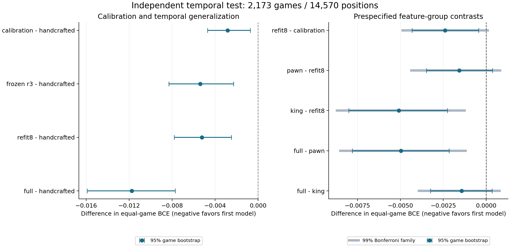
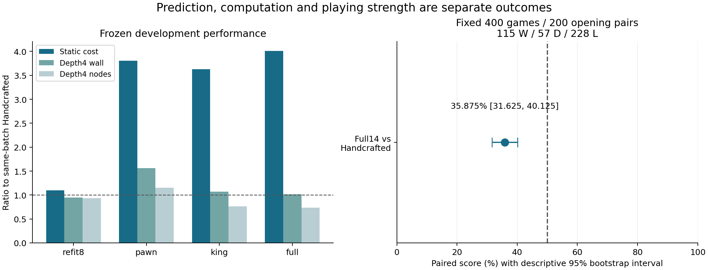

# R4 数据泛化、可解释评估与棋力研究

R4.1–R4.5研究闭环完成。新14维模型在独立未来测试上改善预测，正式固定400局
却只得115胜/57和/228负、35.875%，配对95%得分区间[31.625%,40.125%]。
本设置的Elo等效差−100.89，区间[−133.95,−69.53]；**没有更换默认评估器的依据，
继续使用Handcrafted**。首次执行因UCI协议输出缺陷中断，原120局完整保留，
修复后只续跑原定剩余280局；这是明确披露的技术偏离，不是单次连续同binary运行。
Windows物理实验主机NOT_RUN；Mac短时控、电池/背景负载和数据窗口限制均保留。

## 研究边界与身份

R4.1–R4.5于2026-10-15一次授权；未启动R5、NNUE、强化学习或MCTS。
R3数据、模型、原始对弈及研究报告全部保留；本轮不重解释R3的小样本棋力结果。

| 环节 | 实际版本/状态 |
|---|---|
| 预注册 | `4e1bb700e0db1fda5d15571e3a795bb4fcbc991b`，采集前 |
| R4.1数据 | `2af9bb0f98f21ea4e69c0aa65bf860e7e58abc36` |
| R4.2基准实现 | `37d72807319d1085ecf755827ce131c2f0430470` |
| 冻结R3来源修复 | `a0c34436335b6629f0171ad1890b082bd9c4dfe4` |
| 14维特征/拟合 | `00faca452e288ec5f6bf17f410d0c1aec246fb71`，clean |
| 四组性能/候选选择 | `deab47005cad0615d7f150e008c33cb2017311bf`，clean |
| 独立测试/首120局 | `625d84e370395cfd013eeac429b059bb107ca33d`，clean |
| 仅协议修复/剩余280局 | `057f2cf6543028368fb9725f4142e34b7fa85805`，clean |
| 首批binary SHA-256 | `4792a7bd89b57059d77a941d5b7006a01913abbccd5a219e6ec13fa18aaefc06` |
| 续跑binary SHA-256 | `a3f57c70c7f5e2480d835538903d9f785864b3862997ac2afe664c711ed1b725` |
| full模型 SHA-256 | `43e2e1ad509bfef9a529ce98706d6b64004d50166e115d7871a7666b05dd728e` |
| 冻结R3原始模型 SHA-256 | `446d18379cfa66e018c4be56218db044339e4be137309c9a17dfbab69874269b` |

[冻结协议](protocol.md)、[完整验证日志和命令](../validation/r4/commands.md)、
[总工作记录](../../VALIDATION.md)构成恢复依据。协议先固定数据/特征/选择规则，
分析细节及成本聚合口径均在相关结果出现前说明。最终test在候选/模型/分析代码/
开局/成本证据冻结并提交后，仅执行一次；marker不允许意外重跑。

## 1. 扩大时间跨度后，R3八维模型是否仍有预测优势？

在本批独立未来数据上，有条件的预测优势仍存在：冻结R3模型的等棋局BCE比
手工降低0.005389，整局bootstrap95%区间[−0.008322,−0.002298]。
两个未来窗口的点估计均改善。它不等价于跨平台、全月或任意未来年份的保证，
也不证明棋力收益。R4 refit8未明显优于冻结R3；不能把新训练自动视为进步。

### 数据覆盖与独立性

来源为[Lichess标准棋月库](https://database.lichess.org/)，官方CC0许可。
冻结选取2017-02..07六个来源，每源HTTP206读取3MiB压缩前缀，最多4000完整局，
总18MiB；另3MiB用于完全独立的2017-08开局源。没有完整下载大型月库。
R4源24000局，经合法性、Normal终局、双方rating>=1500、base>=180秒、
至少32ply等既有过滤后，保留6670局、44681唯一局面。

| 划分 | 来源月 | 游戏 | 局面 | 实际UTC日期 |
|---|---|---:|---:|---|
| train | 2017-02..05 | 3613 | 24187 | 01-31、02-28、03-31、04-30 |
| validation | 同上，按game hash的20% | 884 | 5924 | 同上 |
| 独立test | 2017-06..07 | 2173 | 14570 | 05-31、06-30 |

四项目标（>=4000局、>=20000局面、>=6UTC日期、严格时间隔离）均满足。
实际月库前缀日期为月名之前一天，保留原UTCDate/UTCTime，不推测其原因。
每个窗口仍只约13–24分钟，是六个分散窗口的方便样本，不能描述为全月随机抽样。
按game ID分割，ply16..160每7ply候选按seed/game/ply哈希最多取8个。
跨split的精确/颜色镜像局面移除75次，内部重复20次。没有同局跨集合。

train/validation、train/test、validation/test共有玩家分别709/398/127。
因此独立观察单位选择整局、每局总权重相等，不能把14570局面当作14570个独立样本；
玩家跨局、日期内聚类仍未消除。只有两个未来时间窗口，不宜对月份总体作精确推断。
ECO HHI约0.015，test前三为C00(93局)、B01(89)、A00(81)；比单一开局覆盖宽，
但ECO不等价于独立战略结构。test仅137和棋局（6.30%），标签不平衡明显。

游戏结果1/.5/0是带噪声的长期结果，不是minimax局面价值。所有比较共用同一冻结
数据与标签。原始每月PGN、合成来源header、过滤计数、UTC/玩家/ECO/标签/阶段/
走棋方诊断、划分和文件hash见[数据包](../../experiments/results/r4-data-v1/manifest.json)。
原始压缩前缀留于本机.tools，源PGN足以离线重建数据；已完整重建一致。

## 2. 原离线变化有多少可由简单概率校准解释？

训练仅学习正尺度s，固定原八维相对权重，p=sigmoid(s*score/400)。s=1.3072725763，
在预定[.01,10]内部。其它模型用float64、train-only等棋局RMS、零截距、BCE和
以手工权重（扩展列为0）为中心的L2；lambda=.0001/.001/.01/.1/1按validation选择。
四个学习组均选.01，20个候选全部收敛。七个部署模型独立重拟合后字节完全一致。

| 模型 | test等棋局BCE | test等棋局Brier |
|---|---:|---:|
| Handcrafted | 0.608264 | 0.196101 |
| 正尺度校准 | 0.605435 | 0.194838 |
| 冻结R3八维 | 0.602875 | 0.193929 |
| R4 refit8 | 0.603040 | 0.194014 |
| base+pawn | 0.601474 | 0.193394 |
| base+king/phase | 0.597949 | 0.191891 |
| full14 | 0.596512 | 0.191315 |

校准相对手工改善BCE0.002829，95%整局区间[−0.004705,−0.000736]。
按点估计的算术分解，约占冻结R3改善的52.5%、refit8改善的54.2%、full14改善的24.1%。
这些比例没有单独置信区间，不是因果贡献比例；各模型并非嵌套的独立干预。
refit8−校准为−0.002395，95%区间排除0，但五对比家族99%区间跨0，不能过强表述。
完整模型相对校准仍改善0.008923，95%区间[−0.012974,−0.005026]。
正尺度保持静态排序的主要结构；校准只作为离线基准，没有据BCE直接部署为棋力提升。

## 3. 哪些新增特征有较可靠的预测改善？

版本interpretable-v2的前8维精确继承v1，后6维为白减黑：
孤兵数、叠兵额外数、通路兵推进量、王前1–2格同/邻文件兵盾数、
遭对手伪攻击的王环格数，以及残局phase加权的国王中心性整数分子。
数学定义/顺序/颜色对称/phase截断见[协议](protocol.md)和[架构](../../ARCHITECTURE.md)。
C++与独立python-chess在全部44681局面精确一致，额外覆盖随机合法局面、
镜像、升变额外子力、兵型、裸王、兵盾、王环、EP/易位及残局边界。

| 预定对比，负值有利前者 | 等棋局BCE差 | 95%整局区间 | 五对比99%边界 |
|---|---:|---|---|
| refit8−校准 | −0.002395 | [−0.004323,−0.000439] | [−0.004865,+0.000095] |
| pawn−refit8 | −0.001565 | [−0.003482,+0.000369] | [−0.004362,+0.000812] |
| king−refit8 | −0.005091 | [−0.008012,−0.002253] | [−0.008698,−0.001258] |
| full−pawn | −0.004963 | [−0.007800,−0.002155] | [−0.008510,−0.001201] |
| full−king | −0.001437 | [−0.003248,+0.000349] | [−0.003916,+0.000778] |

王安全/阶段组的增量证据较强；兵结构方向有利，但新增到base或king后的区间均跨0，
尚不能宣称可靠增益。这是**特征组**证据，不能归因到某一个单独维度。
99%边界只对预定五个BCE对比提供名义Bonferroni控制，bootstrap近似与聚类假设仍限制覆盖；
不覆盖所有分层/Brier/事后解释，也不证明跨月份总体显著性。

### 权重和局限

| 特征 | Handcrafted | refit8 | full14 |
|---|---:|---:|---:|
| Pawn | 100 | 171.930 | 123.242 |
| Knight | 320 | 324.594 | 320.061 |
| Bishop | 330 | 347.255 | 341.174 |
| Rook | 500 | 611.697 | 596.243 |
| Queen | 900 | 1094.659 | 1044.791 |
| Pawn advancement | 5 | 3.818 | 9.466 |
| Minor centrality | 4 | 13.753 | 11.447 |
| Bishop pair | 30 | 50.646 | 57.404 |
| Isolated pawns | — | 0 | −24.596 |
| Doubled excess | — | 0 | −60.746 |
| Passed advancement | — | 0 | 29.308 |
| Pawn shield | — | 0 | 45.037 |
| Attacked king ring | — | 0 | −61.446 |
| Endgame king centrality numerator | — | 0 | 1.153 |

这些是正则化相关模型系数，无系数置信区间，不能按单个权重大小认定棋理因果作用。
full14早期ply16–40的BCE .674357略差于手工.673566；和棋标签.785246明显差于
手工.739291。后期ply41–160 .505612优于.532586，决定性结果.583812优于.599448。
因此总体改善不代表各类局面改善。材料phase与ply是不同划分；中/残局、双方走棋
及两个未来窗口的完整指标保留在[一次test结果](../../experiments/results/r4-models-v1/test-results.json)。
分层仅诊断，未用于重新选特征/模型或修改正式比赛。每层按该层可用局面重新等棋局加权，层间不能直接相加。

## 4. 特征增加对推理成本、搜索树和整体搜索有什么影响？

同一clean deab470 Release binary，QS/TT/PV=true、Hash16、单线程，固定R2十局面，
depth3/4各3次，顺序固定种子打乱；静态每局面7轮交替顺序，每模型100000次。
总480搜索查询、280静态重复，原始UCI transcripts/测量/模型副本/完整hash均保留。

| 模型 | 静态ns/call | 同批手工ns/call | depth4节点 | 同批手工节点 | depth4 wall ms | 同批手工wall ms |
|---|---:|---:|---:|---:|---:|---:|
| refit8 | 27.212 | 24.795 | 249002 | 266968 | 72.844 | 76.663 |
| pawn | 95.609 | 25.146 | 308278 | 266968 | 125.717 | 80.672 |
| king | 100.777 | 27.804 | 203073 | 266968 | 88.111 | 82.046 |
| full14 | 113.949 | 28.442 | 195889 | 266968 | 86.808 | 85.658 |

静态为逐局面中位数的均值；搜索为逐局面重复中位数之和。各组与各自同批手工
比较，避免跨批计时漂移被误解为算法差异。三个v2消融均执行完整14维提取，即便
部分权重为0，因而其成本不能直接解释为单个特征组的边际实现成本。

full14静态约4.01倍，depth4节点少26.62%，wall多1.34%，wall NPS下降约27.6%。
改变评估函数会改变树形/剪枝/完成迭代，节点减少不是自动等价的速度或棋力提升。
所有模型窄范围战术标签6/6；这不是经过标定的战术能力量表。
计时来自Apple A18 Pro/6逻辑CPU/8GiB/macOS、AppleClang21 Release `-O3 -DNDEBUG`，
正式赛前实际为电池85%放电、load averages 7.51/6.06/4.41；benchmark电源状态未单独记录。
桌面负载与电源状态未控制，三次重复不足以给出稳定硬件性能置信度。
Windows Ryzen8940HX物理实验主机未连接，明确NOT_RUN；Windows CI仅证明工程兼容。

## 5. 是否支持提高实际棋力？

不支持。本固定样本显示明显负向结果，条件配对区间也全部低于50%。
200个独立2017-08开局各交换颜色，共400局，1+0.01秒、单并发、Hash16、
QS/TT/PV=true、MoveOverhead10、maxmoves150，无深度/节点限制，无认输或分数和棋裁决。
开局按源game hash排序取首次唯一合法12ply局面，排除R3位置/R4源局，未用模型打分。
EPD重置历史/计数器；双方同样处理，FEN不能恢复此前重复历史。

| 实验 | 局/配对 | W/D/L（Full14） | 得分率 | 配对95%得分区间 |
|---|---:|---|---:|---|
| 首批完整前缀，原执行failed | 120 /60 | 33/19/68 | 35.417% | [29.167%,42.083%] |
| 原定剩余开局续跑 | 280 /140 | 82/38/160 | 36.071% | [30.893%,41.250%] |
| **预定总体** | **400 /200** | **115/57/228** | **35.875%** | **[31.625%,40.125%]** |

总体五档配对计数[64,32,71,19,14]。Elo等效点−100.894，配对区间单调变换为
[−133.947,−69.532]，定义400log10(p/(1−p))。这是本设置的效应标尺，
不是SPRT、普遍定级或跨硬件/长时控保证。固定200轮及2000次配对bootstrap按预定执行，
没有中途择模、改种子、增减样本或为正结果追加比赛。区间未建模开局家族、玩家或
硬件/电源变化；该设计不是用于精确识别10–20 Elo小效应的高功效实验。

391局自然结束：343将杀、25五十步、19三次重复、3子力不足、1逼和。
另9局恰好300ply，按预定150回合上限外部裁和；[逐局记录](../validation/r4/adjudications.json)
保留原因。完整对局异常终止0。9局的未截断结果未知，得分率包含这些外部和棋。

### 协议中断与固定样本恢复

候选仅按validation最低BCE及<=10x静态成本选择full14；先于test和比赛。
首120局使用clean625d84e。第121局Handcrafted在预算耗尽前未完成首层，输出合法
兜底着法和ucl_stats depth0，却没有普通info，触发严格fastchess告警并实际退出1。
原失败状态、120局、完整日志永久保留，普通validate仍拒绝把它判为完成。
仅修复depth0普通info输出后，按续跑前冻结的[恢复计划](../../experiments/results/r4-recovery-v1/plan.json)
完成原开局61..200的140轮；重复的仅为没有产生结果的未完成121局。

续跑clean057f2cf，模型/时控/Hash/开局/总样本不变。自动逐文件核对全部engine代码：
唯一差异为冻结的UCI输出补丁，Search/Evaluator/Features/其它代码相同，编译器/flags相同。
两批实际binary/hash分别保留，不能称为单一binary连续运行。派生研究包从两个原始PGN
重建，只改第二批Round编号，核对400局与全部200原定开局逐项对应，再调用既有配对统计。
156个未完成局查询（各引擎78）单独标记，不混入完整对局性能；未丢弃任何已完成负结果。

首批303.69秒，续跑695.87秒，总实际比赛运行约16分40秒；中间修复间隔另计。
独立test在625d84e唯一完成，没有为恢复比赛重新test或训练。
派生分析的Git dirty状态只涉及报告/审计文件，实际两批引擎均为clean；修改清单见最终审计。

### 实际比赛计算成本

| 统计，完整400局 | Full14 | Handcrafted |
|---|---:|---:|
| 实际着法/完整final-stats覆盖 | 23316 | 23374 |
| 最终总节点（含中断迭代） | 1389596150 | 2019673678 |
| qnodes | 1252360115 | 1804207235 |
| 引擎内部搜索累计秒 | 490.164 | 490.169 |
| 聚合最终NPS | 2834963 | 4120358 |
| 完成深度中位数 | 5 | 5 |
| 完成深度>=6比例，诊断 | 19.66% | 31.95% |
| PGN普通info最后完整层节点 | 714625954 | 1060601285 |

Full14聚合NPS低约31.2%；双方搜索位置不同，不能把该比例当作纯特征提取的因果成本。
中位深度相同不代表整个深度分布相同；高深度亦受强制线/和棋影响。
只看普通info会遗漏未完成迭代近半数节点，因而保留最终ucl_stats至关重要。
原始trace、PGN及每步覆盖检查可重建这些计数。

## 6. 离线预测与对弈可能不一致时，可检验的解释是什么？

以下是可检验的解释假设，不是已确认机制：

- 结果标签偏重最终胜负；和棋及早期预测退步，可能影响搜索决策或重复/和棋倾向。
- 慢速静态提取可能降低同一时钟下完成深度；可用正式trace的节点/NPS/深度诊断，
  后续固定节点比赛与增量提取可区分速度和决策质量，但本轮不追加比赛找正结果。
- 王环/兵盾等线性项可能忽略战术补偿或特征交互；需独立局面价值标签与案例研究。
- game-label训练与搜索所需局面排序并不相同；校准改善本身不保证改进着法。
- 月度前缀、玩家重复和开局集合偏差可能造成分布差异，需要独立更广时间/玩家验证。

## 7. 已验证事实、代码推断与未验证假设

已验证：合法数据重建、固定划分/去重/哈希、C++/Python全量特征/推理一致、
版本化加载/UCI事务、开发选择不访问test、模型复现、一次冻结test、既有工程回归及
实际保留的benchmark。正式400局开局/配对/终局/原始telemetry及恢复研究包已从源重建核验。

代码推断：正尺度主要保持静态排序；慢特征可能影响每秒搜索预算。性能已测量，
具体对某个着法/胜负的因果作用尚未隔离。

未验证：Windows物理主机表现、更长时控/更广开局、跨月份总体泛化、单维棋理因果作用、
NNUE或MCTS优于当前方案。不能将CI、smoke、离线BCE或少量战术题转换成这些结论。

## 8. R5方向

优先研究**搜索/评估计算预算与目标对齐**，再决定更复杂评估或NNUE；MCTS目前优先级最低。
具体次序为：新独立时间/玩家覆盖与较可信局面价值标签；早期/和棋目标诊断；
冻结模型的增量/低成本特征提取及固定节点对照，以区分吞吐损失和局面排序质量。
这些是后续研究建议，本轮不追加比赛、不实现R5。

依据是：full14静态成本4.01倍，实战NPS少31.2%，BCE改善却有−101 Elo等效负结果；
仅提高预测拟合能力不足以解决这种目标/预算差异。王安全/阶段组值得保留为候选，
兵结构增量仍不确定，不能凭总体BCE继续堆特征。NNUE应在标签/评价准则和高效增量
推理基础上再作独立比较；当前没有其棋力证据。MCTS缺少policy/value证据及算力依据，
会引入更多混杂因素。R4 test已打开，未来模型选择必须配新的独立test，不能复用为最终盲测。

## 原始证据与缺陷保留

- [数据与诊断](../../experiments/results/r4-data-v1/manifest.json)、
  [八维特征](../../experiments/results/r4-features-v1/manifest.json)、
  [14维特征](../../experiments/results/r4-features-v2/manifest.json)。
- [全部候选/开发选择](../../experiments/results/r4-models-v1/selection.json)、
  [成本与候选冻结](../../experiments/results/r4-models-v1/freeze.json)、
  [一次独立test](../../experiments/results/r4-models-v1/test-results.json)。
- [refit8性能](../../experiments/results/r4-benchmarks-v1/refit8/report.md)、
  [pawn性能](../../experiments/results/r4-benchmarks-v1/pawn/report.md)、
  [king性能](../../experiments/results/r4-benchmarks-v1/king/report.md)、
  [full性能](../../experiments/results/r4-benchmarks-v1/full/report.md)。
- [独立开局源/选择](../../experiments/results/r4-openings-v1/manifest.json)、
  [冻结比赛配置](../../experiments/configs/r4-match.json)、
  [原执行failed记录](../../experiments/results/r4-match-final-20261015/record.json)、
  [续跑记录](../../experiments/results/r4-match-continuation-20261015/record.json)、
  [完整400局研究入口](../../experiments/results/r4-study-final-20261015/record.json)。
- [完整命令与日志](../validation/r4/commands.md)、[验证记录](../../VALIDATION.md)。

R4.2首次模型文件重封装了冻结R3权重的来源hash，权重未变但不应混淆为原始部署身份；
v1原样保留为来源缺陷历史，v2直接复制原R3文件，后续正式研究使用其原始sha。
一次手写通路兵fixture推进量错误（2应为1）已修正，失败日志保留；C++与Python原本一致。
原始PGN/log末尾空行按生成器原字节保留，未为样式检查改写研究证据。

## 工程验收与状态

| 项目 | 状态与证据 |
|---|---|
| R4.1 跨时间数据/独立划分/源重建 | PASS，2af9bb0；6670局/44681局面/6日期 |
| R4.2 校准/冻结R3/refit8/等棋局基准 | PASS，37d7280/a0c3443；独立test625d84e |
| R4.3 14维/消融/安全部署/性能 | PASS，00faca4/deab470；全量一致、四组benchmark |
| R4.4 固定200轮研究 | PASS（恢复分析），625d84e首执行FAIL，057f2cf按原计划完成剩余140轮；不是单次同binary运行 |
| R4.5 报告/证据重建 | 本地审计PASS，最终归档CI后封存 |
| 棋力改善假设 | 本设置FAIL：得分区间低于50%；保留Handcrafted |
| Windows8940HX物理实验主机 | NOT_RUN，无连接端点；Mac fallback已实际执行 |

本地Release/Debug/ASan+UBSan各6/6 CTest，含unit/search/perft/真实UCI/实验/研究工具；
fastchess compliance40/40。初版与修复后的C++均有针对性及完整回归，日志见验证索引。
最终审计从原始PGN重新构建R3两版及R4数据，核对特征/模型/冻结test与全部16个保留
实验记录（其中原失败包只接受显式完整前缀），重建400局研究，确认R1–R3既有证据、
Search及原Handcrafted源码不变，默认仍为Handcrafted，无生成binary/build/venv入Git。

对应精确SHA的五项Actions：
[R4.1](https://github.com/Ultramarine-1011/Ultramarine_Chess_Lab/actions/runs/38718363121)、
[R4.2](https://github.com/Ultramarine-1011/Ultramarine_Chess_Lab/actions/runs/38718439833)、
[来源修复](https://github.com/Ultramarine-1011/Ultramarine_Chess_Lab/actions/runs/38718766589)、
[R4.3](https://github.com/Ultramarine-1011/Ultramarine_Chess_Lab/actions/runs/38719798185)、
[冻结性能版本](https://github.com/Ultramarine-1011/Ultramarine_Chess_Lab/actions/runs/38720180531)、
[协议/Windows修复057f2cf](https://github.com/Ultramarine-1011/Ultramarine_Chess_Lab/actions/runs/38731674339)
均五项success。625d84e的[原CI](https://github.com/Ultramarine-1011/Ultramarine_Chess_Lab/actions/runs/38729565254)
是Mac三项success、Windows两项因POSIX路径断言失败，已修复并保留失败日志。
最终归档提交的CI状态另在末尾同步，不将先前run冒充为最新SHA。

重要身份的完整SHA-256、文件大小、数据/模型/配置/图表路径见
[机器可读产物索引](artifact-index.json)。源码与实际编译flags在各记录内；
原625d84e二进制通过隔离重建逐字节重现4792a7bd...，续跑实际a3f57c70...二进制已保存本机.tools。
这证明构建身份可复现，不保证时钟比赛跨硬件逐局结果相同。原压缩数据前缀和可执行文件不入Git。

R4研究结果为负仍构成有效研究闭环。默认保持Handcrafted；不启动R5。
